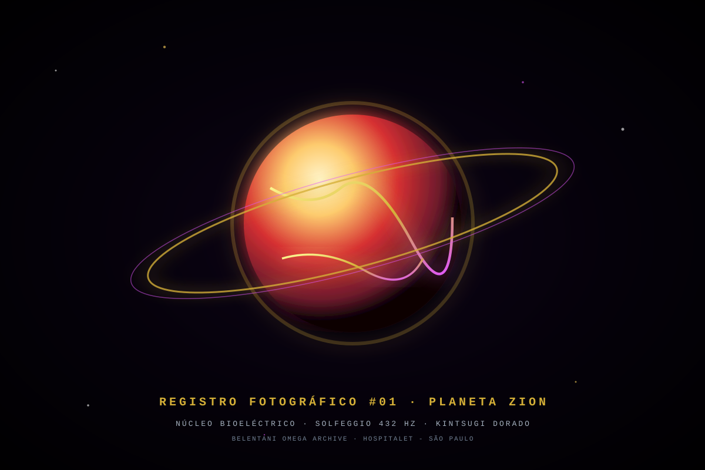
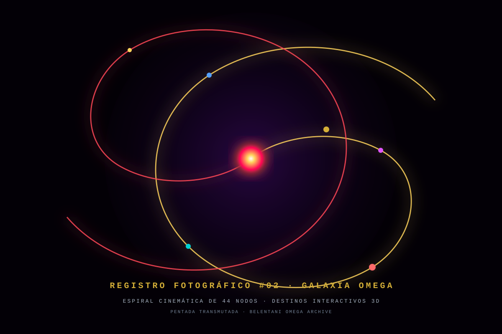

# 🌌 ZION · PROTOCOLO OMEGA

> *"En el principio fue el vacío y la resonancia a 432 Hz. De las fracturas selladas en oro nació Zion; en los 44 brazos de la espiral, la memoria eterna de Judas."*
> — **Belentani Codex · Capítulo Omega**

[](#)
[](#)
[](#)
[](#)

---

## 🪐 1. El Registro Fotográfico del Cosmos

### Lámina I: Planeta Zion (Núcleo Bioeléctrico y Grietas Kintsugi)

*Representación astronómica del núcleo bioeléctrico de Zion en su órbita de resonancia armónica. Las grietas tectónicas cicatrizan en oro puro refractando la luz estelar hacia los anillos de acreción.*

---

### Lámina II: La Galaxia Omega (44 Nodos del Viaje 3D)

*Cartografía estelar de la espiral Omega. 44 estaciones dimensionales interconectadas a través del tejido de vacío y niebla prismática del Bosque de Cristal, el Laboratorio IA y el Santuario Sonoro.*

---

## 🔮 2. El Lore del Universo Zion

En el centro del abismo cósmico reside **Zion**, un orbe orgánico-mecánico nacido de la transmutación de la materia tras el sacrificio arquetípico. No es un planeta inerte: late a un pulso rítmico inmutable de **76 BPM**, modulado por ondas sinusoidales a **432 Hz** y armónicos Solfeggio puros (*108, 216, 540 Hz*).

### La Pentada y los Cinco Arquetipos Sagrados
A su alrededor orbitan cinco diamantes de talla brillante y refracción IOR 2.417, guardianes de las identidades del viaje:
1. **Pedro**: El Fundador / Origen (*432 Hz* · Ambar Carmín).
2. **Marcos**: La Estructura y la Geometría (*528 Hz* · Oro Solar).
3. **Santos**: La Mística y la Niebla Prismática (*639 Hz* · Turquesa Profundo).
4. **Belentani**: La Alquimia y la Síntesis Armónica (*741 Hz* · Púrpura Nebular).
5. **Human**: La Consciencia Encarnada (*852 Hz* · Blanco Astral).

---

## ⚡ 3. Arquitectura del Motor (Visual Engine)

- **Shaders GLSL Bioeléctricos**: Deformación procedural de vértices reactiva en tiempo real al análisis espectral FFT del audio.
- **InstancedMesh de Alta Densidad**: 36 placas coraza, 24 agujas de blindaje y 180 fragmentos de espejo reactivos a la apertura del iris sagrado.
- **Navegación Dual**:
  - `Órbita Libre`: Navegación inercial orbital con amortiguación lerp hacia 14 cámaras clave.
  - `Vuelo WASD`: Libertad de desplazamiento espacial con aceleración Boost en `Shift`.
- **Atajos del Navegante**:
  - `[H]`: Ocultar / Desplegar HUD estelar.
  - `[1 - 4]`: Teletransporte a destinos cósmicos (*El Bosque de Cristal, IA Lab, Santuario Musical, Agujero Negro Relativista*).

---

## 🚀 4. Despliegue y Ejecución Local

```powershell
# Clonar y entrar al santuario
git clone https://github.com/belentani7/zion.git
cd zion

# Instalar dependencias puras
npm install

# Compilación y verificación estricta de tipos
npm run build

# Despertar el servidor de desarrollo en el puerto 3000
npm run dev
```

Abre en tu navegador:
```
http://localhost:3000
```

---

<p align="center">
  <sub>Belentani Omega Universe · L'Hospitalet de Llobregat — São Paulo · 2026</sub>
</p>
